# 01 팀원용. 카메라의 state space와 flow

> [01 문서](01-camera-markov-process.md)를 수업에서 배운 Markov process에 맞대어 풀어 쓴 글입니다. 증명은 빼고 그림으로 설명합니다. 정확한 정의와 증명은 01 문서에 있습니다.

## 1. 한눈에 보기

수업의 Markov process는 state가 몇 개뿐이고, 한 걸음씩 다음 state로 넘어갑니다. 카메라는 다릅니다. 볼 수 있는 방향이 끊김 없이 이어져 있고, 시간도 끊김 없이 흐릅니다.

이 글은 수업의 그림을 그 경우로 옮깁니다. 옮기고 나면 다음과 같이 짝이 맞습니다.

| 수업 | 이 글 |
|---|---|
| state 몇 개(노드) | 원통 위의 점 전체 $\mathcal S$ |
| random state의 수열 $S_0,S_1,S_2,\dots$ | 시각마다 하나씩인 $S_t$ |
| 간선 | 화살표 $s\xrightarrow{\,u\,}s'$ |
| Markov property | 과거와 상관없는 그 뒤 |
| $n$번의 전이 $\mathcal P^n$ | $u$초의 전이 $T_u$ |
| $\mathcal P^{m+n}=\mathcal P^m\mathcal P^n$ | $T_{t+u}=T_u\circ T_t$ |

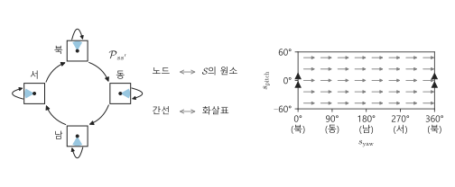

> 그림 1. 왼쪽이 수업의 유향그래프이고, 오른쪽이 이 글에서 만들 그림입니다. 노드는 $\mathcal S$의 점이 되고, 간선은 점에서 점으로 가는 화살표가 됩니다.

## 2. 카메라와 state

방 안의 한 점에 카메라가 고정되어 있습니다. 카메라는 좌우(yaw)와 위아래(pitch)로만 돌고, pitch에는 위아래 한계가 있습니다.

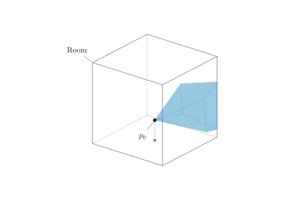

> 그림 2. 카메라는 점 $p_0$에 고정되어 방향만 바꿉니다. 칠한 부분이 지금 화면에 들어온 공간입니다.

출발점으로 삼는 전제는 둘입니다.

1. 지금의 상황으로 주어지는 것은 지금 화면에 들어온 공간뿐입니다.
2. 그 뒤가 어떻게 이어질 수 있는지는 지금의 상황만으로 정해집니다. 그 앞이 어땠는지와 지금이 언제인지는 상관없습니다.

전제 1에 따라, 화면에 들어온 공간 하나를 state 하나로 삼습니다. 방향 $s$에서 화면에 들어오는 공간을 $\mathrm{View}(s)$로 적습니다.

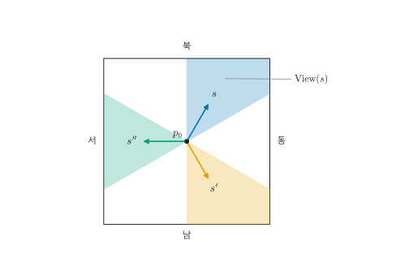

> 그림 3. 방을 위에서 내려다본 그림입니다. 방향이 다르면 화면에 들어오는 공간 $\mathrm{View}(s)$도 다릅니다.

거꾸로, 화면에 들어온 공간만 알아도 방향을 되찾을 수 있습니다. 카메라가 방 안쪽에 놓여 있으므로, 카메라 바로 둘레에서는 시야가 벽에 잘리지 않기 때문입니다.

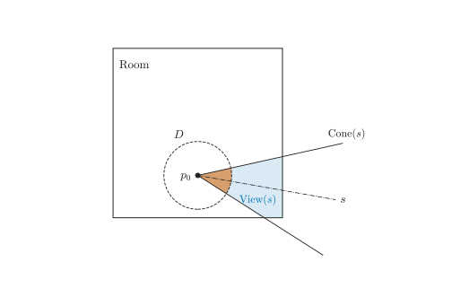

> 그림 4. 카메라 둘레의 작은 공 $D$ 안에서는 시야 $\mathrm{Cone}(s)$가 벽에 잘리지 않습니다. 이 부분만 보아도 시야 전체와 그 가운데 축, 곧 방향을 알 수 있습니다.

그래서 state와 방향은 하나씩 짝이 맞고, state를 그 방향으로 적어도 됩니다.

$$s=(s_{\mathrm{yaw}},\,s_{\mathrm{pitch}})$$

가능한 state 전체를 state space라 하고 $\mathcal S$로 적습니다. yaw는 한 바퀴 돌면 제자리로 오고 pitch는 위아래 한계 사이를 움직이므로, $\mathcal S$는 원통의 옆면입니다. 수업의 state 집합에 해당하지만, 원소가 끊김 없이 이어져 있습니다.

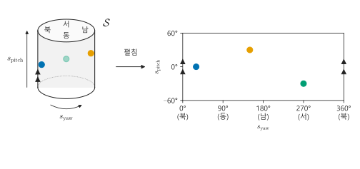

> 그림 5. state 하나가 원통 위의 점 하나입니다. 오른쪽은 원통을 세로로 잘라 펼친 것이고, 뒤의 그림 몇 장은 이 펼친 모양 위에 그립니다.

## 3. 시각 $t$의 state

카메라가 어떻게 움직일지는 하나로 정해져 있지 않습니다. 처음에 어느 방향을 보는지부터 주어지지 않았기 때문입니다. 그래서 일어날 수 있는 운동을 모두 모아 집합 $\Omega$로 둡니다. $\Omega$의 원소 $\omega$ 하나가 처음부터 끝까지의 운동 하나입니다.

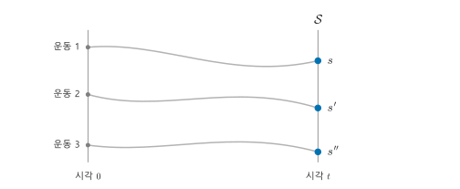

> 그림 6. 선 하나가 운동 하나입니다. 가로는 시간이고, 세로에는 $\mathcal S$를 한 줄로 줄여 그렸습니다. 시각 $t$의 세로선에 찍힌 점이 그 운동의 시각 $t$ state입니다.

운동 $\omega$가 시각 $t$에 놓인 state를 $S_t(\omega)$로 적습니다.

$$S_t:\Omega\to\mathcal S,\qquad \omega\ \longmapsto\ S_t(\omega)$$

$S_t$는 운동을 넣으면 state가 나오는 function입니다. 수업에서 random state라고 부른 것이 이 $S_t$입니다. 어느 운동인지 정해지지 않았으니 $S_t$의 값도 정해지지 않았고, 그래서 random이라는 말이 붙습니다.

event는 운동들의 집합입니다. "시각 $t$에 카메라가 구역 $F$를 보고 있다"는 event는 그런 운동을 모두 모은 것입니다.

$$S_t^{-1}(F)=\{\omega\in\Omega:\ S_t(\omega)\in F\}$$

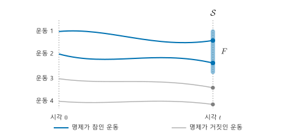

> 그림 7. 시각 $t$의 세로선 위에 구역 $F$를 문처럼 세웠습니다. 그 문을 지나는 굵은 선들이 event $S_t^{-1}(F)$입니다. 범례의 "명제가 참인 운동"은 시각 $t$에 $F$ 안에 있는 운동이라는 뜻입니다.

같은 것을 두 집합으로 그리면 이렇습니다.

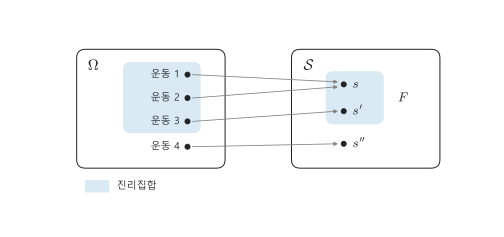

> 그림 8. 화살표가 $S_t$입니다. 운동마다 시각 $t$의 state가 하나 정해지고, 여러 운동이 같은 state로 갈 수 있습니다. 오른쪽에 칠한 곳이 $F$이고, 왼쪽에 칠한 곳이 $F$로 가는 운동들, 곧 $S_t^{-1}(F)$입니다. 범례의 "진리집합"은 이 두 곳을 가리킵니다.

확률은 event에 매기는 수입니다. "$S_t=s$일 확률"은 state $s$에 매긴 수가 아니라, 시각 $t$에 $s$에 놓이는 운동들에 매긴 수입니다.

$\mathcal S$는 하나이지만 $S_t$는 시각마다 하나씩 있습니다. 수업의 $S_0,S_1,S_2,\dots$에서 시각을 끊김 없이 넓힌 것이 $(S_t)_{t\ge0}$입니다.

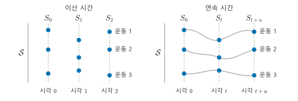

> 그림 9. 세로 방향의 $\mathcal S$는 하나입니다. 시각마다 세운 세로선이 서로 다른 $S_0$, $S_t$, $S_{t+u}$이고, 같은 운동도 세로선마다 다른 state에 놓입니다.

두 시각에 걸친 event는 교집합으로 적습니다.

$$S_t^{-1}(F_1)\cap S_{t+u}^{-1}(F_2)$$

시각 $t$에는 $F_1$ 안에, 시각 $t+u$에는 $F_2$ 안에 있는 운동들입니다.

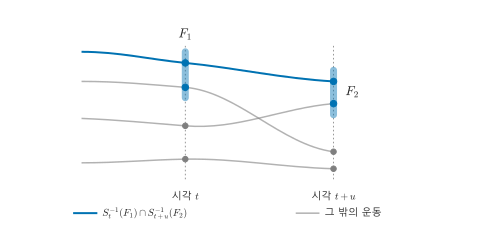

> 그림 10. 시각 $t$의 문 $F_1$과 시각 $t+u$의 문 $F_2$입니다. 두 문을 모두 지나는 굵은 선이 교집합에 속하는 운동입니다.

state 하나만 보아서는 이런 말을 하지 못합니다. state 하나는 그 시각의 일만 알려 주기 때문입니다.

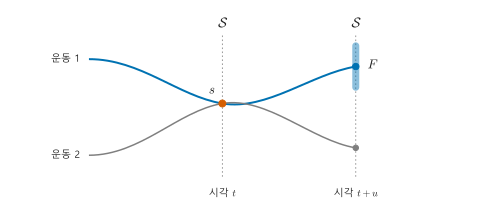

> 그림 11. 두 운동은 시각 $t$에 같은 state $s$에 놓이지만, 시각 $t+u$에는 한쪽만 $F$ 안에 있습니다. 그래서 여러 시각에 걸친 말은 state가 아니라 운동들의 집합으로 합니다.

우리가 흔히 "지금의 state"라고 부르는 것과 $S_t$는 가리키는 것이 다릅니다. 운동을 하나 정하면 시각 $t$의 state는 점 하나입니다. 운동을 정하지 않으면 "state가 $s$"라는 말은 시각 $t$에 $s$를 지나는 운동 전체를 가리킵니다.

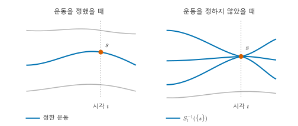

> 그림 12. 왼쪽은 운동을 하나 정한 경우이고, 시각 $t$의 state는 점 하나입니다. 오른쪽은 운동을 정하지 않은 경우이고, "state가 $s$"는 시각 $t$에 $s$를 지나는 운동 전체를 가리킵니다.

표로 적으면 한눈에 보입니다. 행은 운동, 열은 시각, 칸은 state입니다. "지금의 state"는 한 칸이고, $S_t$는 한 열 전체이며, event는 행들의 집합입니다. rollout을 모은 배열로 치면 `states[i][t]`가 한 칸이고 `states[:, t]`가 한 열입니다.

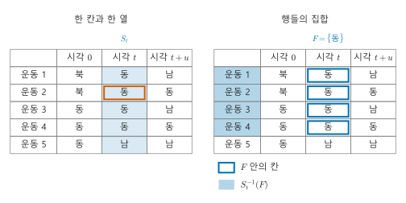

> 그림 13. 왼쪽 표에서 테두리를 친 한 칸이 운동 2의 시각 $t$ state이고, 칠한 열이 $S_t$입니다. 오른쪽 표에서 시각 $t$의 칸이 $F$ 안에 있는 행들이 event $S_t^{-1}(F)$입니다.

## 4. Flow

전제 2는 $S_t$들이 서로 어떻게 이어지는지를 말합니다. 풀어 쓰면 세 가지입니다.

- 어떤 state에서든 시작할 수 있습니다.
- 지금 state가 같으면, 그 전에 어디를 거쳐 왔든 그 뒤에 갈 수 있는 곳이 같습니다.
- 지금이 언제인지도 상관없습니다.

이 세 가지를 지키는 $(S_t)_{t\ge0}$를 flow라 합니다. 둘째가 수업의 Markov property에 해당합니다.

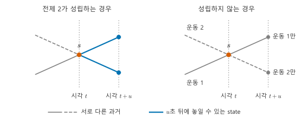

> 그림 14. 과거가 다른 두 운동이 시각 $t$에 같은 state $s$에 놓였습니다. 그 뒤에 놓일 수 있는 state는 어느 과거를 거쳤든 같습니다.

$s$에서 $u$초 뒤에 $s'$에 놓일 수 있으면 화살표로 적습니다. 수업의 간선에 해당합니다.

$$s\xrightarrow{\,u\,}s'$$

state 하나가 아니라 구역 $F$에서 출발할 때는, $F$의 state에서 화살표가 닿는 state 전체를 $T_u(F)$로 적습니다.

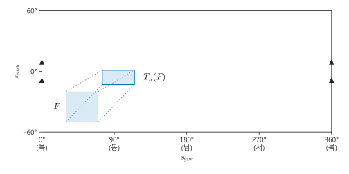

> 그림 15. 펼친 원통 위에 그렸습니다. 지금 $F$ 안에 있을 때 $u$초 뒤에 놓일 수 있는 state 전체가 $T_u(F)$입니다. 화살표는 그 가운데 state 하나에서 state 하나로 가는 경우입니다.

운동으로 말하면, 시각 $t$에 $F$ 안에 있던 운동은 $u$초 뒤에 모두 $T_u(F)$ 안에 있습니다.

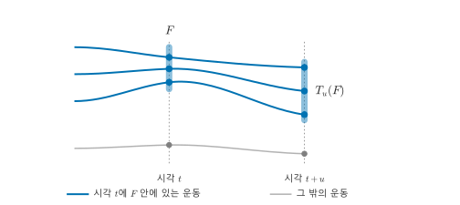

> 그림 16. 시각 $t$의 문 $F$를 지난 운동은 시각 $t+u$에 모두 문 $T_u(F)$를 지납니다.

화살표는 이어 붙일 수 있습니다. $t$초에 갈 수 있는 곳에서 다시 $u$초에 갈 수 있는 곳이, $t+u$초에 갈 수 있는 곳입니다.

$$\boxed{T_{t+u}=T_u\circ T_t}$$

수업에서 $m$번 전이하고 $n$번 더 전이하면 $m+n$번 전이한 것과 같다는 식 $\mathcal P^{m+n}=\mathcal P^m\mathcal P^n$과 같은 자리입니다.

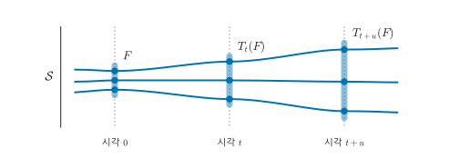

> 그림 17. 가운데 state $s'$을 거쳐 화살표 둘을 이은 것이 $t+u$초의 화살표입니다.

flow의 예를 둘 듭니다. 첫째는 yaw만 일정한 빠르기 $c$로 도는 카메라입니다.

$$s\xrightarrow{\,u\,}(s_{\mathrm{yaw}}+cu,\ s_{\mathrm{pitch}})$$

둘째는 yaw가 같은 빠르기로 돌면서 pitch가 정해진 높이 $a$로 다가가는 카메라입니다. $k$가 클수록 빨리 다가갑니다.

$$s\xrightarrow{\,u\,}\big(s_{\mathrm{yaw}}+cu,\ a+e^{-ku}(s_{\mathrm{pitch}}-a)\big)$$

두 예 모두 state마다 나가는 화살표가 하나뿐입니다.

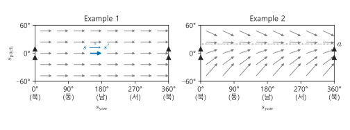

> 그림 18. 펼친 원통 위에 state마다 화살표 $s\xrightarrow{\,u\,}s'$를 그렸습니다. 첫째 예에서는 yaw만 돌고, 둘째 예에서는 pitch가 $a$로 모입니다. 그림의 Example 1과 2가 이 두 예입니다.

## 5. 수업의 MP와 나란히

수업은 Markov property를 이렇게 적었습니다.

$$\mathbb P[S_{t+1}\mid S_t]=\mathbb P[S_{t+1}\mid S_1,\dots,S_t]$$

과거를 더 알아도 다음 state의 확률이 달라지지 않는다는 식입니다. flow의 둘째 조건은 같은 말을 확률이 아니라 "갈 수 있는가"로 적은 것입니다.

수업의 $\mathcal P_{ss'}$는 state 하나의 성질이 아닙니다. 시각 $t$에 $s$에 놓인 운동들 가운데 다음 시각에 $s'$에 놓이는 운동들에 매긴 수이고, $S_t$와 $S_{t+1}$을 잇는 규칙입니다.

$$\mathcal P_{ss'}=\mathbb P[S_{t+1}=s'\mid S_t=s]$$

이 글의 화살표는 그 수를 얹을 자리입니다. 화살표가 하나뿐이면 그 뒤가 하나로 정해지고, 4절의 두 예가 이 경우입니다. 화살표가 여럿이면 운동이 여러 갈래로 퍼지고, 수업은 갈래마다 확률을 얹습니다.

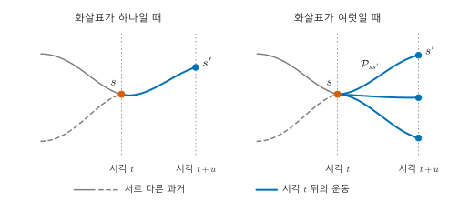

> 그림 19. 과거가 다른 두 운동이 시각 $t$에 같은 state $s$에 놓였습니다. 왼쪽은 화살표가 하나여서 그 뒤가 하나로 정해지는 경우입니다. 오른쪽은 화살표가 여럿이어서 운동이 여러 갈래로 퍼지는 경우이고, 수업은 이 갈래마다 확률을 얹습니다.

## 6. 기호 모음

| 기호 | 읽는 법 |
|---|---|
| $s$ | state 하나. 카메라의 방향 |
| $\mathcal S$ | state 전체. 원통의 옆면 |
| $\omega$, $\Omega$ | 운동 하나, 가능한 운동 전체 |
| $S_t$ | 시각 $t$의 state. 운동을 넣으면 state가 나옴 |
| $S_t^{-1}(F)$ | 시각 $t$에 $F$ 안에 있는 운동들. event |
| $s\xrightarrow{\,u\,}s'$ | $s$에서 $u$초 뒤 $s'$에 놓일 수 있음 |
| $T_u(F)$ | $F$에서 $u$초 뒤에 놓일 수 있는 state 전체 |
