# 02. 초파리와 Markov process

> [01](01-camera-markov-process.md)의 카메라에 초파리를 더해 Markov process를 정의합니다. 그림은 [그림 지침](02-figures.md)대로 만들어 `figures/`에 넣으면 나타납니다.

## 1. 문제 상황

01은 방 안에 카메라만 두었습니다. 이 문서는 그 방에 초파리 한 마리를 둡니다. 초파리는 방 안을 날아다니고, 카메라의 화면에 들어왔다가 나갈 수 있습니다. 이 문서는 초파리가 화면에 들어와 있는 동안만 다룹니다.

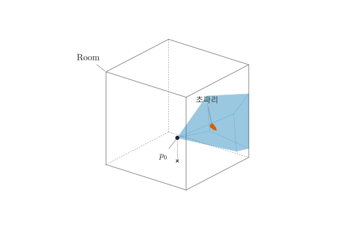

> 그림 1. 방 안에 카메라와 초파리가 있습니다. 칠한 부분이 지금 화면에 들어온 공간이고, 초파리가 그 안에 있습니다.

01의 전제는 둘이었습니다. 이 문서는 전제 1을 넓히고, 전제 2는 그대로 두고, 전제 둘을 더합니다.

1. 한 시각의 상황으로 주어지는 것은 그 시각에 화면에 들어온 공간과, 그 안에 있는 초파리의 위치와 속도뿐입니다.
2. 상황이 무엇이든, 그 뒤가 어떻게 이어질 수 있는지는 그 상황만으로 정해집니다. 그 앞이 어땠는지와 그 시각이 언제인지에는 달려 있지 않습니다.
3. 카메라의 회전은 물리법칙만을 따릅니다. 지금 보는 방향이 같으면 그 뒤에 보는 방향도 같습니다.
4. 초파리는 그렇지 않습니다. 지금의 상황이 같아도 그 뒤는 여러 가지로 이어질 수 있습니다. 어느 쪽으로 이어지는지의 확률은 지금의 상황만으로 정해지고, 그 앞이 어땠는지와 그 시각이 언제인지에는 달려 있지 않습니다.

전제 3과 4도 전제 2와 같습니다. 살펴 얻은 사실도, 다른 것에서 끌어낸 결과도 아니고, 이 문서가 두는 가정입니다.

01은 그 뒤가 하나로 정해지는 경우와 여러 갈래로 이어지는 경우를 나누어 놓고 끝났습니다. 이 문서는 두 경우가 각각 언제인지에서 시작합니다. 카메라만 있을 때가 앞의 경우이고, 초파리가 들어오면 뒤의 경우가 됩니다.

## 2. 물리법칙만 있을 때

먼저 초파리가 없는 01의 상황을 봅니다.

**Notation.** 01의 state space를 이 문서에서는 $\mathcal S_{\mathrm{cam}}$으로, 그 원소를 $s_{\mathrm{cam}}$으로 적습니다. 이 절의 $S_t$와 $T_u$는 01의 것, 곧 방 안에 카메라만 있을 때의 것입니다.

01은 $T_u(\{s_{\mathrm{cam}}\})$의 원소가 하나인지 여럿인지를 정하지 않았습니다. 전제 2는 그 뒤가 어떻게 이어질 수 있는지가 state만으로 정해진다고 했을 뿐, 이어지는 길이 하나라고 하지는 않았기 때문입니다.

전제 3이 이것을 정합니다. 지금의 state가 $s_{\mathrm{cam}}$이면 $u$초 뒤의 state는 하나뿐입니다. 그 state를 $s'_{\mathrm{cam}}$이라 하면

$$T_u(\{s_{\mathrm{cam}}\})=\{s'_{\mathrm{cam}}\}$$

입니다.

01에서 시각 $t$에 $F$ 안에 있던 운동은 $u$초 뒤에 모두 $T_u(F)$ 안에 있었습니다.

$$S_t^{-1}(F)\subseteq S_{t+u}^{-1}\big(T_u(F)\big)$$

$F$를 $\{s_{\mathrm{cam}}\}$으로 잡으면, 시각 $t$에 $s_{\mathrm{cam}}$에 놓인 운동은 $u$초 뒤에 모두 $s'_{\mathrm{cam}}$에 놓입니다.

**Theorem 1**

$T_u(\{s_{\mathrm{cam}}\})=\{s'_{\mathrm{cam}}\}$이면 다음이 성립합니다.

$$\boxed{S_t^{-1}(\{s_{\mathrm{cam}}\})\subseteq S_{t+u}^{-1}(\{s'_{\mathrm{cam}}\})}$$

시각 $t$의 state가 같은 운동은 $u$초 뒤의 state도 같습니다.

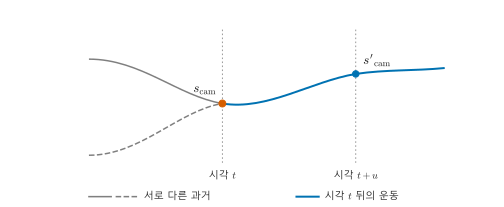

> 그림 2. 과거가 다른 두 운동이 시각 $t$에 같은 state에 놓였습니다. 그 뒤로는 두 운동이 모든 시각에 같은 state에 놓입니다.

$u$는 어떤 값이든 되므로, 시각 $t$의 state가 같은 두 운동은 그 뒤의 모든 시각에 state가 같습니다. $t$를 $0$으로 잡으면, 출발 state가 같은 두 운동은 모든 시각에 state가 같습니다. 출발 state 하나가 그 뒤의 state를 모두 정합니다.

그러므로 카메라만 있을 때 문제 상황이 정하지 않고 남기는 것은 출발 state뿐입니다. 01의 Example 1과 2에서 $\Omega$를 state space 자신으로 잡을 수 있었던 것이 이 때문입니다.

01의 6절은 확률을 얹을 자리가 $T_u(\{s_{\mathrm{cam}}\})$의 원소라고 했습니다. 그 원소가 하나뿐이므로, 여기서는 확률이 가를 것이 없습니다.

## 3. 초파리와 state

이제 방에 초파리를 둡니다. 넓힌 전제 1에 따르면 한 시각의 상황은 화면에 들어온 공간과 그 안의 초파리의 위치와 속도입니다.

전제 1이 위치와 함께 속도를 든 까닭은 전제 2에 있습니다. 초파리의 위치가 같아도 날아가는 쪽이 다르면 그 뒤에 놓일 수 있는 곳이 다릅니다. 위치만으로는 그 뒤를 말하기에 모자랍니다. 01의 5절에서 처음 돌던 쪽으로만 도는 카메라가 방향만으로는 그 뒤를 말할 수 없었던 것과 같습니다.

**Notation.** 초파리의 위치와 속도의 쌍을 $s_{\mathrm{fly}}$로 적고, 가능한 $s_{\mathrm{fly}}$ 전체를 $\mathcal S_{\mathrm{fly}}$로 적습니다.

화면에 들어온 공간은 01의 Theorem 1에 따라 카메라의 방향 $s_{\mathrm{cam}}$ 하나와 대응합니다. 그래서 한 시각의 상황은 쌍 $(s_{\mathrm{cam}},s_{\mathrm{fly}})$로 적힙니다. 초파리가 화면에 들어와 있으므로, $s_{\mathrm{fly}}$의 위치는 $\mathrm{View}(s_{\mathrm{cam}})$ 안에 있습니다.

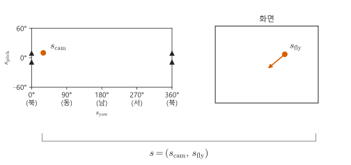

> 그림 3. 왼쪽은 원통 위의 점 $s_{\mathrm{cam}}$이고, 오른쪽은 그때 화면에 들어온 공간과 그 안의 초파리입니다. 화살이 초파리의 속도입니다. 둘을 묶은 쌍 하나가 한 시각의 상황입니다.

초파리가 화면 밖으로 나가면 이 문서가 다루는 범위가 끝납니다. 끝난 뒤는 state 하나로 적습니다.

**Notation.** 초파리가 화면 밖으로 나간 뒤의 state를 $s_{\mathrm{end}}$로 적습니다.

**Definition 1 — State, state space**

화면에 들어온 공간과 그 안의 초파리의 위치와 속도를 묶은 쌍 $(s_{\mathrm{cam}},s_{\mathrm{fly}})$, 그리고 $s_{\mathrm{end}}$를 state라 합니다. 가능한 state 전체의 집합

$$\boxed{\mathcal S=\{(s_{\mathrm{cam}},s_{\mathrm{fly}}):\ s_{\mathrm{fly}}\text{의 위치가 }\mathrm{View}(s_{\mathrm{cam}})\text{ 안에 있다}\}\cup\{s_{\mathrm{end}}\}}$$

를 state space라 합니다. state는 $s$, $s'$, $s''$으로 적습니다.

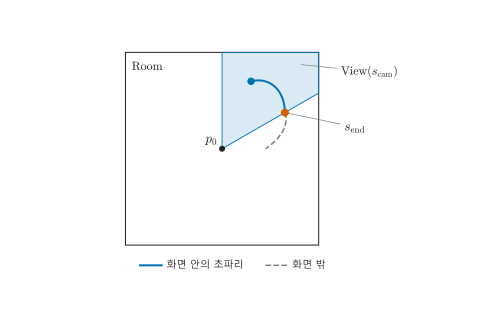

> 그림 4. 방을 위에서 내려다본 그림입니다. 초파리가 $\mathrm{View}(s_{\mathrm{cam}})$ 안에 있는 동안은 쌍이 state이고, 화면 밖으로 나간 뒤의 state는 $s_{\mathrm{end}}$입니다.

01의 3절부터 5절은 state space가 원통이라는 사실을 쓰지 않았습니다. 쓴 것은 시각마다 state가 하나씩 있다는 것, 그 state가 주어지지 않았다는 것, 그리고 전제 2입니다. 이 셋은 새 $\mathcal S$에서도 그대로입니다. 그래서 01의 3절부터 5절을 $\mathcal S$로 바꾸어 읽습니다.

**Notation.** 여기서부터 $\Omega$는 카메라와 초파리의 운동이 움직이는 범위입니다. $S_t$는 $\mathcal S$의 event $F$에 $\Omega$의 event $S_t^{-1}(F)$를 대응시키는 시각 $t$의 state입니다. $T_u(F)$는 지금 $F$ 안에 있을 때 $u$초 뒤에 놓일 수 있는 state 전체입니다.

전제 2에 따라 $(S_t)_{t\ge0}$는 $\mathcal S$ 위의 flow이고, 01의 Theorem 2가 그대로 성립합니다.

$$T_{t+u}=T_u\circ T_t$$

$s_{\mathrm{end}}$에 놓인 운동은 그 뒤로도 $s_{\mathrm{end}}$에 놓입니다.

$$T_u(\{s_{\mathrm{end}}\})=\{s_{\mathrm{end}}\}$$

## 4. 뒤가 여럿일 때

$\mathcal S$의 state $s=(s_{\mathrm{cam}},s_{\mathrm{fly}})$에서 $u$초 뒤를 봅니다.

전제 3에 따라 카메라의 state는 초파리가 있어도 하나로 정해집니다. 그 state를 $s'_{\mathrm{cam}}$이라 합니다. 전제 4에 따라 초파리의 state는 하나로 정해지지 않습니다.

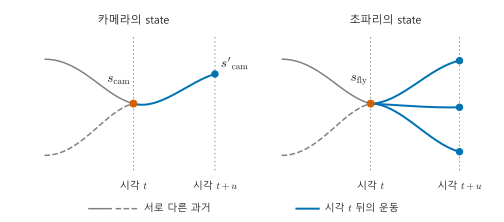

> 그림 5. 왼쪽은 카메라의 state이고 그 뒤가 하나로 이어집니다. 오른쪽은 초파리의 state이고 그 뒤가 여러 갈래로 퍼집니다.

그래서 $T_u(\{s\})$의 원소는 여럿일 수 있습니다. 그 원소들은 카메라의 state가 모두 $s'_{\mathrm{cam}}$이고 초파리의 state가 서로 다른 쌍들입니다. 초파리가 그 사이에 화면 밖으로 나갈 수 있으면 $s_{\mathrm{end}}$도 듭니다.

01이 이 경우에 말해 주는 것은 $T_u(\{s\})$, 곧 놓일 수 있는 state 전체입니다.

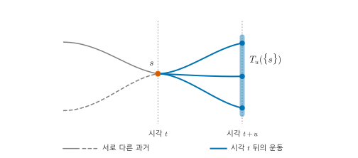

> 그림 6. 과거가 다른 두 운동이 시각 $t$에 같은 state $s$에 놓였습니다. 그 뒤는 여러 갈래이고, 시각 $t+u$의 문 $T_u(\{s\})$가 놓일 수 있는 state 전체입니다.

갈래마다 얼마만큼의 운동이 이어지는지는 $T_u(\{s\})$에 담겨 있지 않습니다. 운동의 대부분이 한 갈래로 가는 경우와 여러 갈래로 고르게 가는 경우는 $T_u(\{s\})$가 같을 수 있습니다. flow는 이 둘을 가르지 못합니다.

## 5. 전이 확률 kernel

교재는 갈래마다 확률을 얹습니다. 01의 6절에서 본 대로, 확률은 state가 아니라 event에 매기는 수입니다.

**Notation.** $\Omega$의 event $E_1$에 매긴 확률을 $\mathbb P[E_1]$로 적습니다. $E_1$에 속하는 운동들 가운데 $E_2$에도 속하는 운동들의 확률은 교재의 표기대로 $\mathbb P[E_2\mid E_1]$로 적습니다.

수업의 $\mathcal P_{ss'}$는 state $s$에서 다음 시각에 state $s'$에 놓일 확률입니다.

$$\mathcal P_{ss'}=\mathbb P[S_{t+1}=s'\mid S_t=s]$$

수업에서는 state가 몇 개뿐이어서, 이 수를 $s'$마다 적으면 $s$에서의 전이를 다 적은 것입니다. state들의 집합 $F$ 안에 놓일 확률은 $F$의 state마다의 수를 더해 얻습니다.

$$\mathbb P[S_{t+1}\in F\mid S_t=s]=\sum_{s'\in F}\mathcal P_{ss'}$$

$\mathcal S$에서는 이렇게 되지 않습니다. 초파리의 위치와 속도는 끊김 없이 이어져 있어서, $u$초 뒤에 놓일 수 있는 state가 한 구역을 빈틈없이 채울 수 있습니다. 그러면 state 하나하나에 놓일 확률은 모두 $0$인데 구역에 놓일 확률은 $0$이 아닐 수 있습니다.

> **Example 1.** 초파리의 빠르기가 초속 $0.2$m와 $0.5$m 사이에 고르게 놓인다고 합니다. 정확히 초속 $0.3$m일 확률은 $0$입니다. 초속 $0.3$m와 $0.4$m 사이일 확률은 $\tfrac13$입니다.

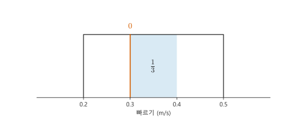

> 그림 7. 확률이 한 구간에 고르게 퍼져 있습니다. 구역의 확률은 그 위의 넓이입니다. state 하나는 폭이 없어서 확률이 $0$입니다.

이때 state에서 state로 얹은 수는 모두 $0$이어서, 그것을 더해서는 구역의 확률을 얻지 못합니다. state에서 state로 얹은 수만으로는 전이를 다 적지 못합니다.

한편 카메라만 있는 2절의 경우에는 그 뒤의 state가 하나이므로, 그 state 하나에 확률 $1$이 놓입니다. 확률이 state 하나에 모이는 경우와 구역에 퍼지는 경우를 함께 적으려면, 수를 state 하나가 아니라 event에 얹어야 합니다.

그래서 state $s$와 시간 $u$와 $\mathcal S$의 event $F$마다 수를 하나씩 둡니다. 지금 $s$에 있을 때 $u$초 뒤에 $F$ 안에 놓일 확률입니다.

$u$초 뒤에는 $\mathcal S$의 어느 state엔가 놓이므로, $F$가 $\mathcal S$ 전체이면 이 수는 $1$입니다. $F_1$과 $F_2$가 겹치지 않으면, 둘 가운데 어느 한쪽에 놓일 확률은 각각에 놓일 확률의 합입니다.

**Definition 2 — Transition probability kernel**

state $s$, 시간 $u\ge0$, $\mathcal S$의 event $F$마다 $0$과 $1$ 사이의 수 $\mathcal P_u(s,F)$를 하나씩 주되

$$\boxed{\mathcal P_u(s,\mathcal S)=1,\qquad \mathcal P_u(s,F_1\cup F_2)=\mathcal P_u(s,F_1)+\mathcal P_u(s,F_2)\quad(F_1\cap F_2=\varnothing)}$$

를 만족하는 것을 $\mathcal S$ 위의 transition probability kernel이라 합니다. 줄여서 kernel이라 적습니다.

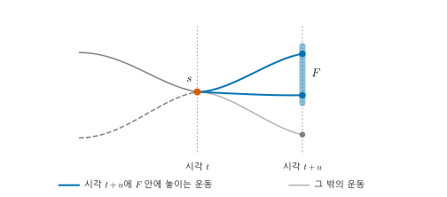

> 그림 8. 시각 $t$에 state $s$에 놓인 운동들이 여러 갈래로 퍼집니다. $\mathcal P_u(s,F)$는 그 가운데 시각 $t+u$의 문 $F$를 지나는 운동들의 확률입니다.

## 6. Markov process

01의 flow는 조건 2로 정해졌습니다. $E$는 01에서처럼 시각 $t$까지의 state에 관한 event입니다. $E$가 $S_t^{-1}(\{s\})$와 겹치면

$$E\cap S_t^{-1}(\{s\})\cap S_{t+u}^{-1}(F)\neq\varnothing\iff S_0^{-1}(\{s\})\cap S_u^{-1}(F)\neq\varnothing$$

입니다. 왼쪽은 과거 $E$를 거쳐 시각 $t$에 $s$에 놓인 운동 가운데 $u$초 뒤 $F$ 안에 놓이는 것이 있는지를 말합니다. 오른쪽에는 $E$도 $t$도 남지 않습니다.

전제 4는 같은 것을 확률로 말합니다. 과거 $E$를 거쳐 시각 $t$에 $s$에 놓인 운동들 가운데 $u$초 뒤 $F$ 안에 놓이는 운동들의 확률은

$$\mathbb P\big[S_{t+u}^{-1}(F)\ \big|\ E\cap S_t^{-1}(\{s\})\big]$$

입니다. 전제 4에 따라 이 확률은 지금의 state $s$와 시간 $u$와 event $F$만으로 정해지고, 과거 $E$와 시각 $t$에는 달려 있지 않습니다. 그 값이 $\mathcal P_u(s,F)$입니다.

**Definition 3 — Markov process**

$\mathcal S$ 위의 flow $(S_t)_{t\ge0}$, $\Omega$의 event에 매긴 확률 $\mathbb P$, $\mathcal S$ 위의 kernel $\mathcal P_u$가 다음을 만족하면, 이 셋을 묶어 $\mathcal S$ 위의 Markov process라 합니다. 시각 $t$까지의 event $E$가 $S_t^{-1}(\{s\})$와 겹치면

$$\boxed{\mathbb P\big[S_{t+u}^{-1}(F)\ \big|\ E\cap S_t^{-1}(\{s\})\big]=\mathcal P_u(s,F)}$$

입니다.

카메라와 초파리의 $(S_t)_{t\ge0}$가 Markov process라는 것은 증명한 것이 아니라 전제 4로 둔 것입니다. Definition 2와 3은 state space가 무엇이든 그대로 읽힙니다.

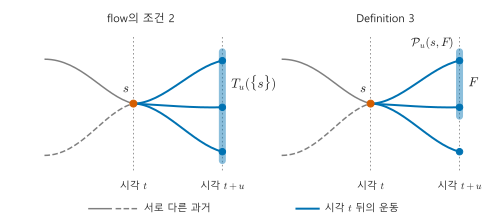

> 그림 9. 과거가 다른 두 운동이 시각 $t$에 같은 state $s$에 놓였습니다. 왼쪽은 flow의 조건 2이고, 그 뒤에 놓일 수 있는 state가 과거와 상관없습니다. 오른쪽은 Definition 3이고, 문 $F$를 지날 확률이 과거와 상관없습니다.

01의 5절에서 시각 $t$에 $s$에 놓인 운동은 $u$초 뒤에 모두 $T_u(\{s\})$ 안에 있었습니다. 그래서 과거 $E$를 거쳐 시각 $t$에 $s$에 놓인 운동들 가운데 $u$초 뒤 $T_u(\{s\})$ 안에 놓이는 운동들의 확률은 $1$입니다. Definition 3에서 $F$를 $T_u(\{s\})$로 잡으면 이 확률이 $\mathcal P_u(s,T_u(\{s\}))$입니다.

**Theorem 2**

Markov process에서 다음이 성립합니다.

$$\boxed{\mathcal P_u\big(s,T_u(\{s\})\big)=1}$$

확률은 놓일 수 있는 state들 위에만 놓입니다. $T_u(\{s\})$는 어디에 놓일 수 있는지를 말하고, $\mathcal P_u(s,F)$는 그 안에서 확률이 어떻게 나뉘는지를 말합니다.

카메라만 있는 2절의 경우에는 $T_u(\{s_{\mathrm{cam}}\})$의 원소가 하나이므로, kernel은 그 하나에 확률 $1$을 줍니다. 초파리가 있으면 그렇지 않습니다.

> **Example 2.** 카메라는 yaw만 일정한 빠르기로 돕니다. 초파리는 곧게 날다가 속도를 새로 뽑고, 다시 곧게 납니다. $u$초 동안 속도를 한 번도 새로 뽑지 않을 확률은 그 앞의 일과 상관없이 $e^{-ku}$입니다. $k$는 $0$보다 큰 상수입니다. 새 속도는 끊김 없이 이어진 범위에서 늘 같은 분포로 뽑습니다.
>
> state $s$에서 $u$초 동안 곧게 날아 놓이는 state를 $s'$이라 합니다. $s'$이 화면 안이면
>
> $$\mathcal P_u(s,\{s'\})=e^{-ku}$$
>
> 입니다. 나머지 확률 $1-e^{-ku}$는 속도를 새로 뽑은 경우들의 구역과 $s_{\mathrm{end}}$에 나뉘어 놓입니다.

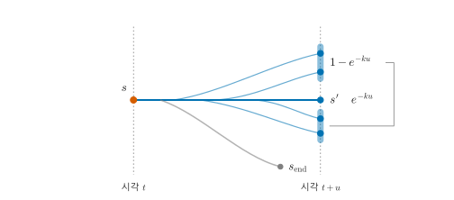

> 그림 10. state $s$에서 곧게 난 운동들은 state $s'$ 하나에 놓이고, 그 확률이 $e^{-ku}$입니다. 속도를 새로 뽑은 운동들은 구역에 퍼지고, 화면 밖으로 나간 운동들은 $s_{\mathrm{end}}$에 놓입니다.

이제 $t$초가 지나고 이어서 $u$초가 지난 경우를 봅니다. 시각 $0$에 $s$에 놓인 운동들 가운데 시각 $t+u$에 $F$ 안에 놓이는 운동들의 확률은, Definition 3에서 $E$를 $\Omega$ 전체로 잡으면 $\mathcal P_{t+u}(s,F)$입니다.

이 운동들을 시각 $t$에 놓인 state $s'$에 따라 나눕니다. $s'$은 $T_t(\{s\})$의 원소이고, Theorem 2에 따라 그 밖의 state에는 확률이 놓이지 않습니다. 시각 $0$에 $s$에, 시각 $t$에 $s'$에 놓인 운동들 가운데 시각 $t+u$에 $F$ 안에 놓이는 운동들의 확률은, Definition 3에서 과거의 event로 $S_0^{-1}(\{s\})$를 잡으면 $\mathcal P_u(s',F)$입니다.

$$\mathbb P\big[S_{t+u}^{-1}(F)\ \big|\ S_0^{-1}(\{s\})\cap S_t^{-1}(\{s'\})\big]=\mathcal P_u(s',F)$$

시각 $0$에 $s$에 놓인 운동들이 시각 $t$에 구역 $F_1$ 안에 놓일 확률은 $\mathcal P_t(s,F_1)$입니다. 확률은 겹치지 않는 경우들로 나누어 더할 수 있습니다. 그래서 시각 $t$의 state $s'$마다의 $\mathcal P_u(s',F)$를 이 확률로 평균하면 $\mathcal P_{t+u}(s,F)$가 됩니다.

state가 몇 개뿐이면 이 평균은 합입니다.

$$\mathcal P_{t+u}(s,F)=\sum_{s'}\mathcal P_t(s,\{s'\})\,\mathcal P_u(s',F)$$

state가 끊김 없이 이어져 있으면 합이 적분으로 바뀝니다.

**Notation.** $s'$마다 값이 정해진 수를 $\mathcal P_t(s,F_1)$이 주는 확률로 평균한 것을 적분 $\int_{\mathcal S}\cdots\,\mathcal P_t(s,ds')$로 적습니다. $\mathcal P_t(s,ds')$는 $s'$ 둘레의 작은 구역에 놓일 확률입니다.

**Theorem 3**

Markov process에서 다음이 성립합니다.

$$\boxed{\mathcal P_{t+u}(s,F)=\int_{\mathcal S}\mathcal P_u(s',F)\,\mathcal P_t(s,ds')}$$

$t+u$초 뒤 $F$ 안에 놓일 확률은, $t$초 뒤에 놓인 state에서 다시 $u$초 뒤 $F$ 안에 놓일 확률을 평균한 것입니다. 01의 Theorem 2는 어디에 놓일 수 있는지를 이어 붙였고, 이 식은 얼마의 확률로 놓이는지를 이어 붙입니다.

Example 2에서 $t$초를 곧게 난 뒤 다시 $u$초를 곧게 날 확률은 $e^{-kt}e^{-ku}$이고, 이것은 $t+u$초를 곧게 날 확률 $e^{-k(t+u)}$와 같습니다.

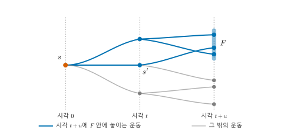

> 그림 11. 시각 $0$에 $s$에서 출발한 운동들이 시각 $t$에 여러 state $s'$으로 퍼지고, 거기서 다시 시각 $t+u$의 문 $F$로 갑니다. $s'$마다의 확률 $\mathcal P_u(s',F)$를 평균한 것이 $\mathcal P_{t+u}(s,F)$입니다.

## 7. 교재와의 대응

교재는 Markov process를 tuple $\langle\mathcal S,\mathcal P\rangle$로 적습니다. 이 문서와는 다음과 같이 대응합니다.

| 교재 | 이 문서 |
|---|---|
| state의 집합 $\mathcal S$ | 쌍과 $s_{\mathrm{end}}$의 집합 $\mathcal S$ |
| random state의 수열 $S_0,S_1,S_2,\dots$ | $(S_t)_{t\ge0}$ |
| $\mathcal P_{ss'}$ | $\mathcal P_u(s,F)$ |
| 한 행의 합이 $1$ | $\mathcal P_u(s,\mathcal S)=1$ |
| Markov property | Definition 3의 식에서 과거 $E$가 빠지는 것 |
| 시각에 따라 변하지 않는 $\mathcal P$ | Definition 3의 식에서 시각 $t$가 빠지는 것 |
| $\mathcal P^{m+n}=\mathcal P^m\mathcal P^n$ | Theorem 3 |
| tuple $\langle\mathcal S,\mathcal P\rangle$ | $\mathcal S$와 $\mathcal P_u$ |

수업의 한 걸음을 $u=1$로 읽으면, $\mathcal P_{ss'}$는 $F$를 state 하나로 잡은 값입니다.

$$\mathcal P_{ss'}=\mathcal P_1(s,\{s'\})$$

수업의 유향그래프에서는 간선마다 수 $\mathcal P_{ss'}$가 붙습니다. 이 문서에서는 state $s$와 event $F$에 수 $\mathcal P_u(s,F)$가 붙습니다.

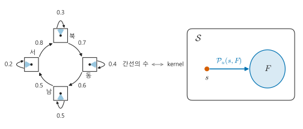

> 그림 12. 왼쪽은 교재의 유향그래프이고 간선마다 수가 붙습니다. 오른쪽은 이 문서이고, state $s$에서 $u$초 뒤의 구역 $F$에 수가 붙습니다.

## 8. 정리

| 개념 | 원인 | 성격 |
|---|---|---|
| 카메라의 뒤가 하나로 정해짐 | 전제 3 | 가정 |
| 출발 state가 그 뒤를 모두 정함 | 전제 3과 01의 $T_u$ | 도출 |
| State space $\mathcal S$ | 넓힌 전제 1 | definition |
| $\mathcal S$ 위의 flow와 $T_u$ | 전제 2 | 01에서 이어받음 |
| 초파리의 뒤가 여럿임 | 전제 4 | 가정 |
| 확률 $\mathbb P$ | 교재 | 교재의 정의 |
| Kernel $\mathcal P_u(s,F)$ | state에서 state로 얹은 수만으로는 전이를 다 적지 못함 | definition |
| Markov process | 전제 4 | definition |
| $\mathcal P_u(s,T_u(\{s\}))=1$ | Definition 3과 01의 $T_u$ | 도출 |
| $\mathcal P_{t+u}(s,F)=\int_{\mathcal S}\mathcal P_u(s',F)\,\mathcal P_t(s,ds')$ | Definition 3 | 도출 |
