# 01. 카메라의 state space와 flow

> 방 안에 고정된 카메라의 회전을 state space와 그 위의 flow로 적습니다. 그림은 [그림 지침](01-figures.md)대로 만들어 `figures/`에 넣으면 나타납니다.

## 1. 문제 상황

방 $\mathrm{Room}$의 안쪽 한 점 $p_0$에 카메라가 고정되어 있습니다. 카메라는 좌우(yaw)와 위아래(pitch)로만 돕니다. pitch는 $c_{\min}$과 $c_{\max}$ 사이에서만 움직이고, 두 한계는 $-90^\circ<c_{\min}<c_{\max}<90^\circ$입니다. 화면은 직사각형이고 화각은 고정되어 있습니다.

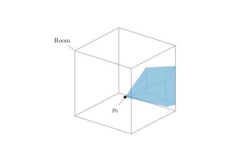

그림 1. 카메라는 점 $p_0$에 고정되어 방향만 바꿉니다. 칠한 부분이 지금 화면에 들어온 공간입니다.

전제는 두 가지입니다.

1. 한 시각의 상황으로 주어지는 것은 그 시각에 화면에 들어온 공간뿐입니다.
2. 상황이 무엇이든, 그 뒤가 어떻게 이어질 수 있는지는 그 상황만으로 정해집니다. 그 앞이 어땠는지와 그 시각이 언제인지에는 달려 있지 않습니다.

## 2. State space

**Notation.** 카메라의 방향을

$$s=(s_{\mathrm{yaw}},\,s_{\mathrm{pitch}})$$

로 적습니다. $s_{\mathrm{yaw}}$는 $360^\circ$를 돌면 같은 방향입니다. 가능한 방향 전체를 $Q$로 적습니다.

**Notation.** 방향 $s$에서 화면에 들어오는 공간은 $p_0$에서 끝없이 뻗는 사각뿔이고, 그 가운데 축이 방향 $s$입니다. 이 사각뿔을 $\mathrm{Cone}(s)$로, 그 가운데 방 안에 있는 부분을

$$\mathrm{View}(s)=\mathrm{Room}\cap\mathrm{Cone}(s)$$

로 적습니다.

전제 1에 따르면 한 시각의 상황은 그 시각의 $\mathrm{View}(s)$입니다.

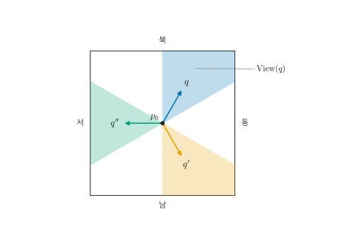

그림 2. 방향이 다르면 화면에 들어오는 공간도 다릅니다. 방을 위에서 내려다본 그림이고, 색마다 방향 하나의 $\mathrm{View}(s)$입니다.

**Definition 1 — State, state space**

화면에 들어온 공간 하나하나를 state라 하고, 가능한 state 전체의 집합

$$\boxed{\mathcal S=\{\mathrm{View}(s):s\in Q\}}$$

를 state space라 합니다.

state를 적는 데 방향 $s$를 썼지만, 서로 다른 두 방향이 같은 state를 주는지는 Definition 1만으로는 정해지지 않습니다.

$p_0$가 $\mathrm{Room}$의 안쪽에 있으므로, $p_0$를 중심으로 하는 작은 공 $D$가 $\mathrm{Room}$ 안에 들어갑니다. 이 공 안에서는 사각뿔이 벽에 잘리지 않으므로

$$\mathrm{View}(s)\cap D=\mathrm{Cone}(s)\cap D$$

입니다. $\mathrm{Cone}(s)\cap D$의 각 점과 $p_0$를 잇는 반직선을 끝없이 늘이면 $\mathrm{Cone}(s)$ 전체가 됩니다. $\mathrm{Cone}(s)$가 정해지면 그 가운데 축이 정해지고, pitch가 $\pm90^\circ$에 닿지 않으므로 축의 방향은 $(s_{\mathrm{yaw}},s_{\mathrm{pitch}})$를 하나로 정합니다.

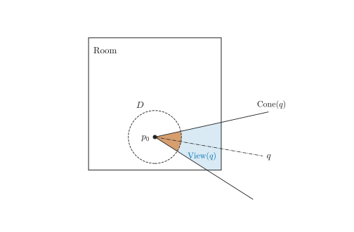

그림 3. 공 $D$ 안에서는 사각뿔이 벽에 잘리지 않습니다. 그래서 $\mathrm{View}(s)$ 가운데 $D$ 안의 부분만으로 사각뿔 전체와 그 축을 되찾습니다.

**Theorem 1**

$$\boxed{\mathrm{View}(s)=\mathrm{View}(s')\ \Longrightarrow\ s=s'}$$

state마다 방향이 하나씩 대응합니다.

**Notation.** 그래서 state $\mathrm{View}(s)$를 그 방향 $s$로 적고, $s_{\mathrm{yaw}}$와 $s_{\mathrm{pitch}}$를 그 state의 coordinate라 합니다. state는 $s$, $s'$, $s''$으로 적습니다.

$s_{\mathrm{yaw}}$는 $360^\circ$마다 되돌아오고 $s_{\mathrm{pitch}}$는 구간 $[c_{\min},c_{\max}]$를 움직입니다. 그래서 coordinate로 본 $\mathcal S$는 원통의 옆면입니다.

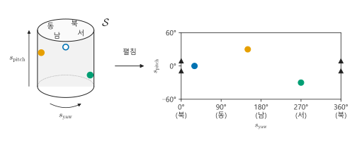

그림 4. state 하나가 원통 위의 점 하나입니다. 오른쪽은 원통을 세로로 잘라 펼친 것이고, 왼쪽 변과 오른쪽 변은 같은 점들입니다.

## 3. 시각 $t$의 state

카메라는 매 순간 어떤 방향을 향하고 있으므로, 시각 $t\ge0$마다 state가 하나씩 있습니다.

그런데 문제 상황은 그 state가 무엇인지 정해 주지 않습니다. 카메라가 처음에 어느 방향을 보는지부터 주어지지 않았습니다. 그래서 카메라의 운동은 하나로 정해지지 않고, 운동이 다르면 같은 시각의 state도 다를 수 있습니다.

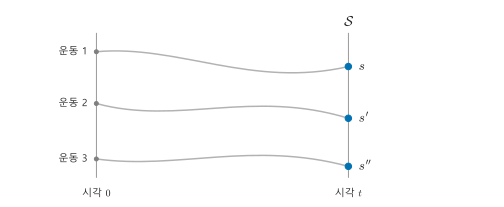

그림 5. 선 하나가 카메라의 운동 하나입니다. 가로는 시간이고, 세로에는 $\mathcal S$를 한 줄로 줄여 그렸습니다. 시각 $t$의 세로선에 찍힌 점이 그 운동의 시각 $t$ state입니다.

$\mathcal S$의 부분집합 $F$를 하나 잡습니다. "시각 $t$의 state가 $F$ 안에 있다"는 명제는 카메라의 어떤 운동에서는 참이고 다른 운동에서는 거짓입니다.

전제 2는 서로 다른 시각의 state가 한 운동에서 어떻게 함께 놓이는지를 말합니다. 이것을 적으려면 여러 시각의 명제를 같은 운동에서 함께 평가해야 합니다. 그래서 운동이 움직이는 범위를 하나의 집합으로 잡습니다.

**Definition 2 — Sample space, event**

카메라의 운동이 움직이는 범위로 잡은 집합 $\Omega$를 sample space라 합니다. 명제가 참인 운동들이 이루는 $\Omega$의 부분집합을 그 명제의 진리집합이라 하고, $\Omega$의 event라 합니다.

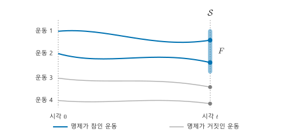

그림 6. 시각 $t$의 세로선 위에 $F$를 문처럼 세웠습니다. 그 문을 지나는 굵은 선들이 "시각 $t$의 state가 $F$ 안에 있다"의 진리집합입니다.

이제 시각 $t$ 하나에 관한 명제들만 봅니다. 이 명제들이 참인지 거짓인지는 그 시각의 state 하나로 정해집니다. 그래서 이 명제들은 $\mathcal S$에서도 평가할 수 있습니다. $\mathcal S$에서 "시각 $t$의 state가 $F$ 안에 있다"의 진리집합은 $F$ 자신입니다. 이 $F$를 $\mathcal S$의 event라 합니다.

$\mathcal S$의 원소 하나에는 여러 운동이 대응합니다. 서로 다른 운동이 시각 $t$에 같은 state에 놓일 수 있기 때문입니다. 그 운동들에서는 시각 $t$에 관한 명제가 참인지 거짓인지가 모두 같습니다. 그래서 이 명제들을 평가하는 데에는 $\mathcal S$로 충분합니다.

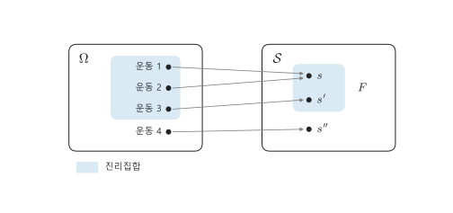

그림 7. 운동마다 시각 $t$의 state가 하나 정해지고, 여러 운동이 같은 state로 갑니다. $\mathcal S$에서의 진리집합 $F$로 가는 운동들이 $\Omega$에서의 진리집합입니다.

다른 시각에 관한 명제까지 $\mathcal S$에서 평가된다는 보장은 없습니다. state 하나는 그 시각의 state만 말하기 때문입니다. 시각 $t$에 같은 state에 놓인 두 운동이 시각 $t+u$에는 서로 다른 state에 놓일 수 있습니다.

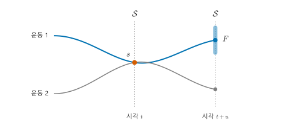

그림 8. 두 운동은 시각 $t$에 같은 state $s$에 놓이지만, 시각 $t+u$에는 한쪽만 $F$ 안에 있습니다. $\mathcal S$의 원소 $s$만으로는 시각 $t+u$에 관한 명제가 참인지 거짓인지 정해지지 않습니다.

그러므로 여러 시각의 명제는 $\Omega$에서 함께 평가합니다. $\mathcal S$의 event $F$를 시각 $t$에 관한 명제의 진리집합으로 읽으면, $\Omega$에서 같은 명제의 진리집합은 시각 $t$의 state가 $F$ 안에 있는 운동들입니다. 이 event를 $S_t^{-1}(F)$로 적습니다.

$$F\ \longmapsto\ S_t^{-1}(F)$$

시각 $t$의 state는 하나뿐입니다. 그래서 $F$ 안에 있지 않다는 것은 $\mathcal S\setminus F$ 안에 있다는 것이고, $F_1$과 $F_2$ 안에 함께 있다는 것은 $F_1\cap F_2$ 안에 있다는 것입니다.

$$S_t^{-1}(\mathcal S\setminus F)=\Omega\setminus S_t^{-1}(F),\qquad S_t^{-1}(F_1\cap F_2)=S_t^{-1}(F_1)\cap S_t^{-1}(F_2)$$

**Definition 3 — 시각 $t$의 state**

$\mathcal S$의 event $F$에 $\Omega$의 event $S_t^{-1}(F)$를 대응시키는 이 대응을 시각 $t$의 state라 하고 $S_t$로 적습니다.

$$\boxed{S_t:\ F\ \longmapsto\ S_t^{-1}(F)}$$

이런 대응을 $\mathcal S$에 값을 갖는 random variable이라 하고, $\mathcal S$를 그 value space라 합니다.

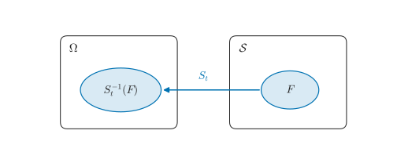

그림 9. 대응은 $\mathcal S$의 event에서 $\Omega$의 event로 갑니다. $S_t^{-1}(F)$는 시각 $t$의 state가 $F$ 안에 있는 운동들입니다.

여기까지의 원인을 한 줄로 줄이면 이렇습니다. $\mathcal S$는 한 시각에 관한 말만 담는데, 전제 2는 여러 시각을 잇는 말입니다. 그 말이 놓이는 곳은 $\Omega$이고, $\mathcal S$의 event를 시각마다 $\Omega$로 옮겨 주는 것이 $S_t$입니다. 그래서 $\mathcal S$는 하나이지만 $S_t$는 시각마다 하나씩 있습니다.

**Notation.** 시각마다 하나씩인 $S_t$들을 한데 묶어 $(S_t)_{t\ge0}$로 적습니다. 이산 시간에서 $S_0,S_1,S_2,\dots$로 적는 random state의 수열을 연속 시간으로 넓힌 것입니다.

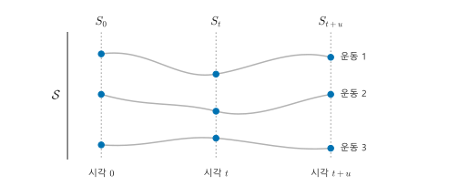

그림 10. 세로 방향의 $\mathcal S$는 하나입니다. 시각마다 세운 세로선이 서로 다른 $S_0$, $S_t$, $S_{t+u}$이고, 같은 운동도 세로선마다 다른 state에 놓입니다.

두 시각에 걸친 event는 $\Omega$ 안의 교집합으로 적습니다.

$$S_t^{-1}(F_1)\cap S_{t+u}^{-1}(F_2)$$

시각 $t$에는 $F_1$ 안에, 시각 $t+u$에는 $F_2$ 안에 있는 운동들입니다. $F_1$과 $F_2$는 둘 다 $\mathcal S$의 부분집합이지만, 두 event는 같은 $\Omega$의 부분집합이어서 겹치는 부분을 따질 수 있습니다.

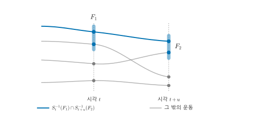

그림 11. 시각 $t$의 문 $F_1$과 시각 $t+u$의 문 $F_2$입니다. 두 문을 모두 지나는 굵은 선이 교집합에 속하는 운동입니다.

이 절의 내용을 세 가지로 모읍니다.

- $\mathcal S$는 random variable이 아니라 value space입니다. 한 시각에 관한 명제들을 평가하는 집합입니다.
- "시각 $t$의 state"는 대응 $S_t$입니다. 교재가 random state라 부르는 것이 이것입니다.
- 여러 시각에 걸친 말은 $\Omega$의 event로 적습니다.

## 4. 통상적인 인식과의 연결

state를 "지금 놓인 상태 하나"로 읽는 통상적인 인식은 $\mathcal S$의 원소를 가리킵니다.

이 인식이 그대로 맞는 자리는 운동이 하나로 정해진 경우입니다. 그때 시각 $t$의 state는 $\mathcal S$의 원소 하나입니다.

이 인식이 닿지 않는 자리는 운동을 정하지 않고 하는 말입니다. "지금 $s$에 있으면 $u$초 뒤에 $s'$에 놓일 수 있다"나 "지금 state를 알면 과거는 필요 없다"는 운동 하나에 관한 말이 아닙니다. 시각 $t$의 state가 $s$인 운동 전체, 곧 event

$$S_t^{-1}(\{s\})$$

에 관한 말입니다.

$\mathcal S$의 원소에는 시각이 붙어 있지 않아서 시각 $t$의 $s$와 시각 $t+u$의 $s$를 가르지 못합니다. $S_t$와 $S_{t+u}$는 value space가 같은 서로 다른 대응이므로 이것을 가릅니다.

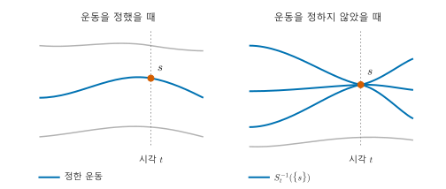

그림 12. 왼쪽은 운동을 하나 정한 경우이고, 시각 $t$의 state는 점 하나입니다. 오른쪽은 운동을 정하지 않은 경우이고, "state가 $s$"는 시각 $t$에 $s$를 지나는 운동 전체를 가리킵니다.

그러므로 두 읽기는 맞고 틀린 관계가 아니라 범위가 다른 관계입니다. 운동을 행으로, 시각을 열로, state를 칸으로 적은 표가 둘을 나란히 놓습니다. 통상적인 인식의 state는 한 칸이고, $S_t$는 한 열이며, event는 행들의 집합입니다.

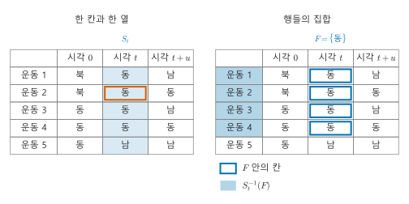

그림 13. 왼쪽 표에서 테두리를 친 한 칸이 운동 2의 시각 $t$ state이고, 칠한 열이 $S_t$입니다. 오른쪽 표에서 시각 $t$의 칸이 $F$ 안에 있는 행들이 event $S_t^{-1}(F)$입니다.

## 5. Flow

전제 2를 $(S_t)_{t\ge0}$로 옮겨 적습니다. 전제 2는 세 가지를 말합니다.

첫째는 "상황이 무엇이든"입니다. 카메라가 처음에 어느 방향을 보는지 주어지지 않았으므로, 어떤 state든 시각 $0$의 state가 될 수 있습니다. 모든 state $s$에서

$$S_0^{-1}(\{s\})\neq\varnothing$$

입니다.

둘째는 "그 앞이 어땠는지에는 달려 있지 않다"입니다. 시각 $t$까지의 state에 관한 event를 $E$로 적습니다. $r\le t$인 $S_r^{-1}(F)$들에서 여집합과 교집합으로 얻는 event입니다. $E$에 속하면서 시각 $t$의 state가 $s$인 운동이 있는 경우를 봅니다.

$$E\cap S_t^{-1}(\{s\})\neq\varnothing$$

그러면 그 가운데 $u$초 뒤 $F$ 안에 놓이는 운동이 있는지는 $E$와 상관이 없습니다.

$$E\cap S_t^{-1}(\{s\})\cap S_{t+u}^{-1}(F)\neq\varnothing\iff S_t^{-1}(\{s\})\cap S_{t+u}^{-1}(F)\neq\varnothing$$

시각 $t$에 $s$에 놓인 뒤 어디로 갈 수 있는지는, 그 전에 어디를 거쳐 왔는지와 상관이 없다는 뜻입니다.

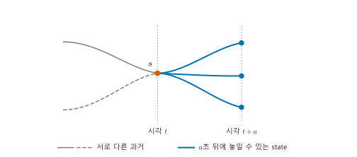

그림 14. 과거가 다른 두 운동이 시각 $t$에 같은 state $s$에 놓였습니다. 그 뒤에 놓일 수 있는 state는 어느 과거를 거쳤든 같습니다.

셋째는 "그 시각이 언제인지에는 달려 있지 않다"입니다. 시각 $t$에 $s$에 놓이는 운동이 있으면, $u$초 뒤 $F$ 안에 놓일 수 있는지는 시각 $0$에 $s$에서 출발한 경우와 같습니다.

$$S_t^{-1}(\{s\})\cap S_{t+u}^{-1}(F)\neq\varnothing\iff S_0^{-1}(\{s\})\cap S_u^{-1}(F)\neq\varnothing$$

**Definition 4 — Flow**

$(S_t)_{t\ge0}$가 위의 세 조건을 만족하면 $\mathcal S$ 위의 flow라 합니다.

전제 2에 따라 카메라의 $(S_t)_{t\ge0}$는 flow입니다. flow는 value space가 같은 $S_t$들의 event가 위의 방식으로 함께 놓인 것입니다.

**Notation.** $\mathcal S$의 event $F$를 하나 잡습니다. 지금 $F$ 안에 있을 때 $u$초 뒤에 놓일 수 있는 state들의 집합을 $T_u(F)$로 적습니다. 셋째 조건에 따라 지금이 언제인지는 상관이 없으므로 시각 $0$으로 적습니다. $T_u(F)$는

$$S_0^{-1}(F)\subseteq S_u^{-1}\big(T_u(F)\big)$$

를 만족하는 가장 작은 event입니다.

시각 $u$의 state는 하나씩 있습니다. 그래서 $s'$이 $T_u(F)$에 속하는 것은, 시각 $0$에 $F$ 안에 있고 시각 $u$에 $s'$에 놓이는 운동이 있을 때입니다.

$$s'\in T_u(F)\iff S_0^{-1}(F)\cap S_u^{-1}(\{s'\})\neq\varnothing$$

**Notation.** state 하나에서 출발하는 경우는 화살표로 적습니다.

$$s\xrightarrow{\,u\,}s'\quad:\Longleftrightarrow\quad s'\in T_u(\{s\})$$

$s$에서 $u$초 뒤에 $s'$에 놓일 수 있다는 뜻입니다. $T_u(F)$는 $F$의 state에서 화살표가 닿는 state 전체입니다.

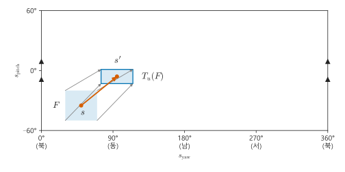

그림 15. 펼친 원통 위에 그렸습니다. 지금 $F$ 안에 있을 때 $u$초 뒤에 놓일 수 있는 state 전체가 $T_u(F)$입니다. 화살표는 그 가운데 state 하나에서 state 하나로 가는 경우입니다.

$T_u$는 시각 $0$으로 적었지만 어느 시각에서나 같은 일을 합니다. 시각 $t$에 $F$ 안의 state $s$에 놓인 운동을 하나 봅니다. 그 운동이 시각 $t+u$에 놓인 state를 $s'$이라 하면, 셋째 조건에 의해 $s\xrightarrow{\,u\,}s'$이고, 따라서 $s'$은 $T_u(F)$에 속합니다.

$$S_t^{-1}(F)\subseteq S_{t+u}^{-1}\big(T_u(F)\big)$$

시각 $t$에 $F$ 안에 있던 운동은 $u$초 뒤에 모두 $T_u(F)$ 안에 있습니다.

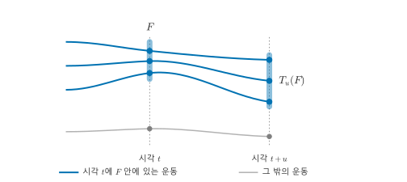

그림 16. 시각 $t$의 문 $F$를 지난 운동은 시각 $t+u$에 모두 문 $T_u(F)$를 지납니다.

$u=0$이면 같은 시각이고, 첫째 조건에 따라 $F$의 state는 모두 시각 $0$의 state가 될 수 있습니다. 그래서

$$T_0(F)=F$$

입니다.

이제 $t$초가 지나고 이어서 $u$초가 지난 경우를 봅니다.

먼저 $s\xrightarrow{\,t+u\,}s''$인 경우입니다. 시각 $0$에 $s$에, 시각 $t+u$에 $s''$에 놓이는 운동이 있습니다. 그 운동은 시각 $t$에 어떤 state $s'$에 놓입니다.

$$S_0^{-1}(\{s\})\cap S_t^{-1}(\{s'\})\cap S_{t+u}^{-1}(\{s''\})\neq\varnothing$$

여기서 $s\xrightarrow{\,t\,}s'$입니다. 또 시각 $t$에 $s'$에, 시각 $t+u$에 $s''$에 놓이는 운동이 있으므로, 셋째 조건에 의해 $s'\xrightarrow{\,u\,}s''$입니다.

거꾸로 $s\xrightarrow{\,t\,}s'$이고 $s'\xrightarrow{\,u\,}s''$인 경우입니다. 시각 $t$에 $s'$에 놓이는 운동이 있으므로, 셋째 조건에 의해 시각 $t$에 $s'$에, 시각 $t+u$에 $s''$에 놓이는 운동이 있습니다. 둘째 조건에서 $E=S_0^{-1}(\{s\})$로 두면, 그런 운동 가운데 시각 $0$에 $s$에 있던 것도 있습니다. 따라서 $s\xrightarrow{\,t+u\,}s''$입니다.

곧 화살표는 이어 붙일 수 있고, 이어 붙인 것이 전부입니다.

$$s\xrightarrow{\,t+u\,}s''\iff \text{어떤 }s'\text{에서}\ \ s\xrightarrow{\,t\,}s'\ \text{이고}\ \ s'\xrightarrow{\,u\,}s''$$

$T_u(F)$는 $F$의 state에서 화살표가 닿는 state 전체이므로, 이 식은 모든 event $F$에서 $T_{t+u}(F)=T_u(T_t(F))$라는 것입니다.

**Theorem 2**

$$\boxed{T_{t+u}=T_u\circ T_t}$$

$t+u$초에 닿는 state는 $t$초에 닿은 state에서 다시 $u$초에 닿는 state입니다.

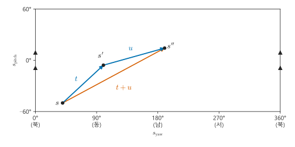

그림 17. 가운데 state $s'$을 거쳐 화살표 둘을 이은 것이 $t+u$초의 화살표입니다.

> **Example 1.** $c$가 상수일 때, $\Omega$를 $\mathcal S$ 자신으로 잡고
>
> $$S_t^{-1}(F)=\{s\in\mathcal S:\ (s_{\mathrm{yaw}}+ct,\ s_{\mathrm{pitch}})\in F\}$$
>
> 로 둡니다. 출발 state가 $s$이면 시각 $t$의 state가 $(s_{\mathrm{yaw}}+ct,\ s_{\mathrm{pitch}})$라는 뜻입니다. 출발 state가 그 뒤의 state를 모두 정하므로, 운동을 출발 state로 가리킨 것입니다. $c(t+u)=ct+cu$이므로, 시각 $t+u$의 state는 시각 $t$의 state에서 yaw에 $cu$를 더한 것입니다. 그래서 세 조건이 성립하고, $s$에서 나가는 화살표는
>
> $$s\xrightarrow{\,u\,}(s_{\mathrm{yaw}}+cu,\ s_{\mathrm{pitch}})$$
>
> 하나입니다.
>
> **Example 2.** 같은 $c$와 $k>0$, 그리고 $c_{\min}\le a\le c_{\max}$인 $a$를 잡습니다. $\Omega$를 $\mathcal S$ 자신으로 잡고
>
> $$S_t^{-1}(F)=\{s\in\mathcal S:\ (s_{\mathrm{yaw}}+ct,\ a+e^{-kt}(s_{\mathrm{pitch}}-a))\in F\}$$
>
> 로 둡니다. pitch는 한계 안에 머뭅니다. $e^{-k(t+u)}=e^{-ku}e^{-kt}$이므로, 시각 $t+u$의 state는 시각 $t$의 state로 정해집니다. 그래서 세 조건이 성립하고, $s$에서 나가는 화살표는
>
> $$s\xrightarrow{\,u\,}\big(s_{\mathrm{yaw}}+cu,\ a+e^{-ku}(s_{\mathrm{pitch}}-a)\big)$$
>
> 하나입니다.

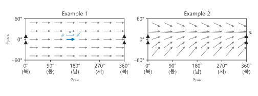

그림 18. 펼친 원통 위에 state마다 화살표 $s\xrightarrow{\,u\,}s'$를 그렸습니다. Example 1에서는 yaw만 돌고, Example 2에서는 pitch가 $a$로 모입니다.

## 6. 교재와의 대응

교재는 Markov process를 random state의 수열과 tuple $\langle\mathcal S,\mathcal P\rangle$로 적습니다. 이 문서와는 다음과 같이 대응합니다.

| 교재 | 이 문서 |
|---|---|
| 노드 | $\mathcal S$의 원소 |
| 간선 | 화살표 $s\xrightarrow{\,u\,}s'$ |
| random state의 수열 $S_0,S_1,S_2,\dots$ | $(S_t)_{t\ge0}$ |
| Markov property | Flow의 둘째 조건 |
| 시각에 따라 변하지 않는 $\mathcal P$ | Flow의 셋째 조건 |
| $n$번의 전이 $\mathcal P^n$ | $u$초의 전이 $T_u$ |
| $\mathcal P^{m+n}=\mathcal P^m\mathcal P^n$ | Theorem 2 |

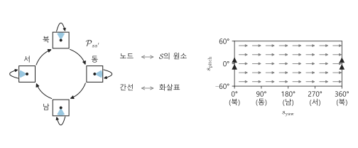

그림 19. 교재의 유향그래프에서는 노드에서 노드로 간선이 이어집니다. 이 문서에서는 $\mathcal S$의 원소에서 원소로 화살표가 이어집니다.

교재는 Markov property를

$$\mathbb P[S_{t+1}\mid S_t]=\mathbb P[S_{t+1}\mid S_1,\dots,S_t]$$

로 적습니다. 과거를 더 알아도 다음 state의 확률이 달라지지 않는다는 식입니다. Flow의 둘째 조건은 같은 말을 확률이 아니라 "놓일 수 있는가"로 적은 것입니다.

교재에서 확률은 event에 매기는 수입니다. $\mathbb P[S_t=s]$는 state $s$에 매긴 수가 아니라, 시각 $t$에 $s$에 놓이는 운동들에 매긴 수입니다.

$$\mathbb P[S_t=s]=\mathbb P\big[S_t^{-1}(\{s\})\big]$$

교재의 $\mathcal P_{ss'}$도 state 하나의 성질이 아닙니다. 시각 $t$에 $s$에 놓인 운동들 가운데 다음 시각에 $s'$에 놓이는 운동들에 매긴 수이고, $S_t$와 $S_{t+1}$을 잇는 규칙입니다.

$$\mathcal P_{ss'}=\mathbb P[S_{t+1}=s'\mid S_t=s]$$

이 문서의 화살표 $s\xrightarrow{\,u\,}s'$는 그 수를 얹을 자리입니다. $s$에서 나가는 화살표가 하나뿐이면, 시각 $t$에 $s$에 놓인 운동은 모두 $u$초 뒤 같은 state $s'$에 놓입니다.

$$S_t^{-1}(\{s\})\subseteq S_{t+u}^{-1}(\{s'\})$$

Example 1과 2가 이 경우입니다. 화살표가 여럿이면 운동들이 여러 state로 갈라지고, 교재는 갈래마다 확률을 얹습니다.

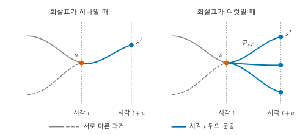

그림 20. 과거가 다른 두 운동이 시각 $t$에 같은 state $s$에 놓였습니다. 왼쪽은 화살표가 하나여서 그 뒤가 하나로 정해지는 경우입니다. 오른쪽은 화살표가 여럿이어서 운동이 여러 갈래로 퍼지는 경우이고, 교재는 이 갈래마다 확률을 얹습니다.

## 7. 정리

| 개념 | 원인 | 성격 |
|---|---|---|
| State space $\mathcal S$ | 전제 1 | definition |
| Coordinate와 원통 | Theorem 1 | 도출 |
| Sample space $\Omega$ | 전제 2가 여러 시각의 state를 함께 말함 | 선택 |
| 시각 $t$의 state $S_t$ | 시각마다 state가 하나씩 있고, 그 state가 주어지지 않음 | 도출된 대응의 이름 |
| Flow | 전제 2 | definition |
| $T_u(F)$와 $s\xrightarrow{\,u\,}s'$ | Flow의 세 조건 | notation |
| $T_{t+u}=T_u\circ T_t$ | Flow의 둘째와 셋째 조건 | 도출 |
